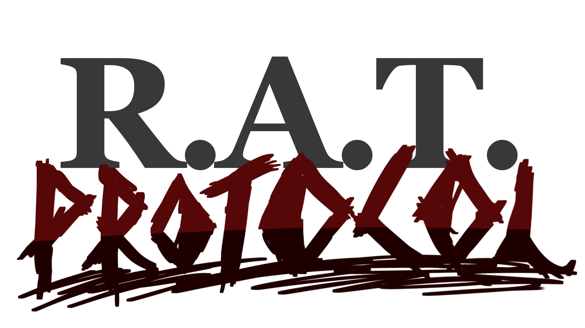
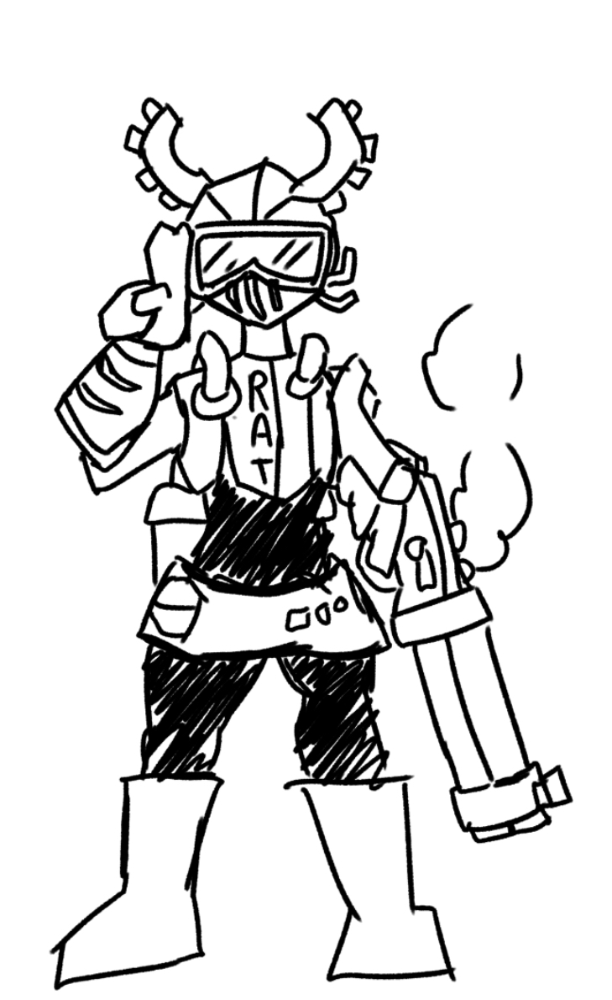
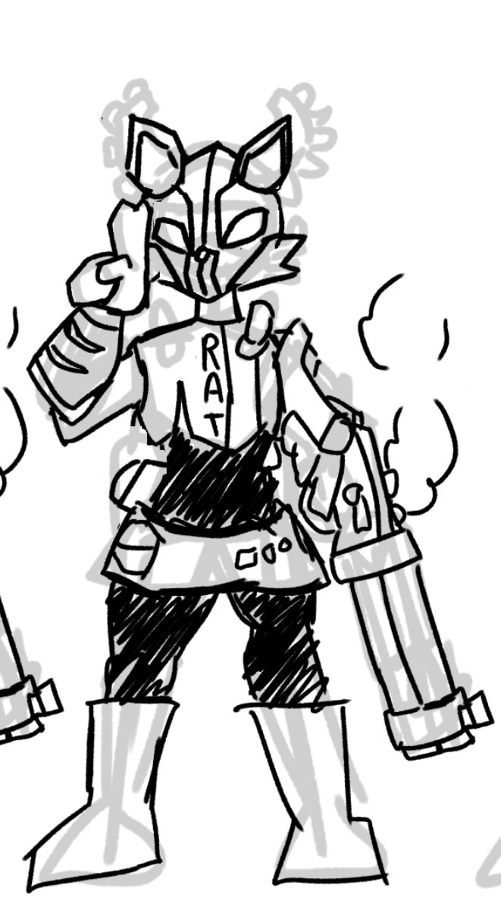
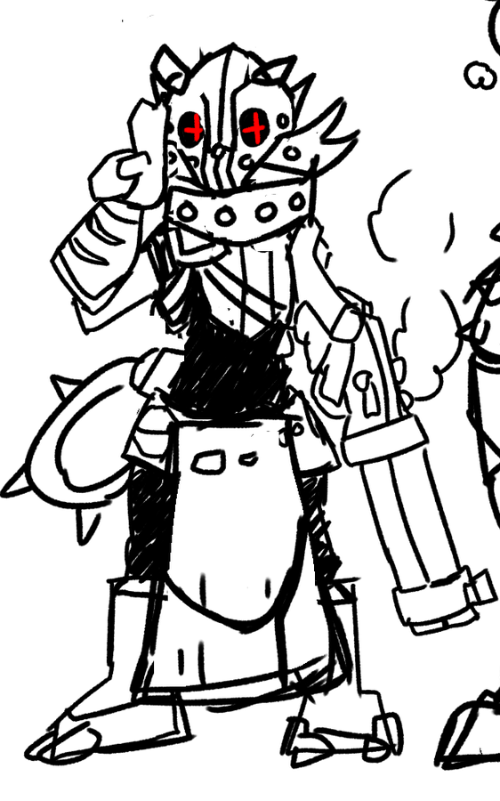
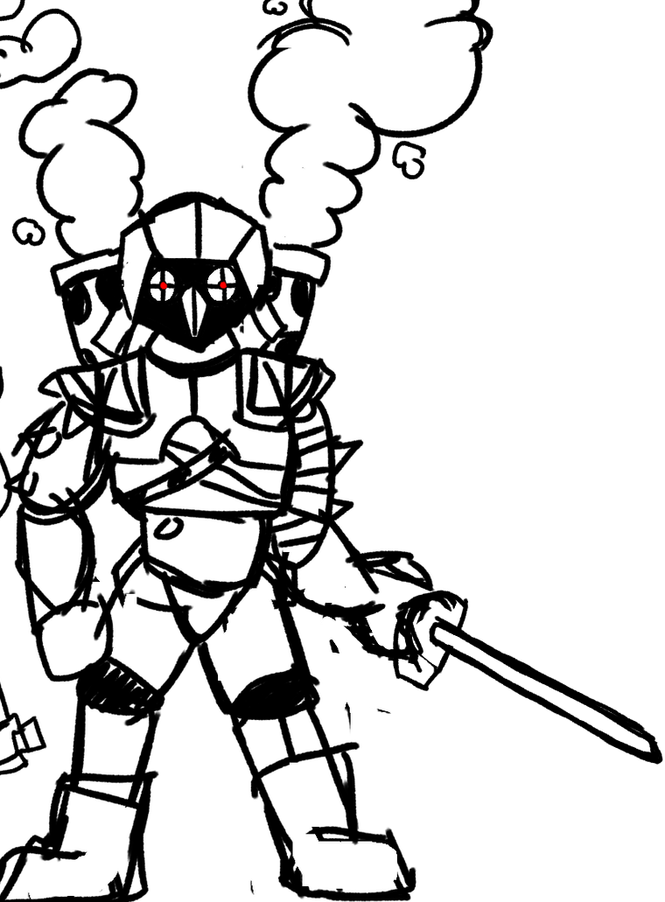
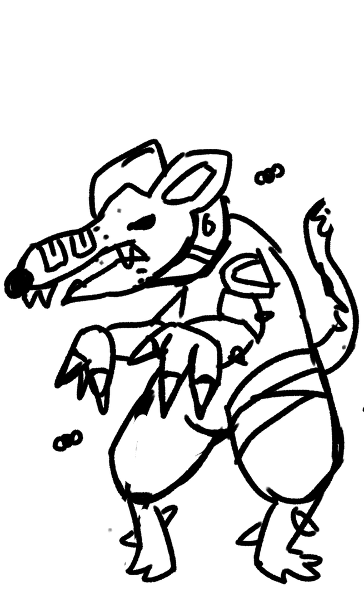
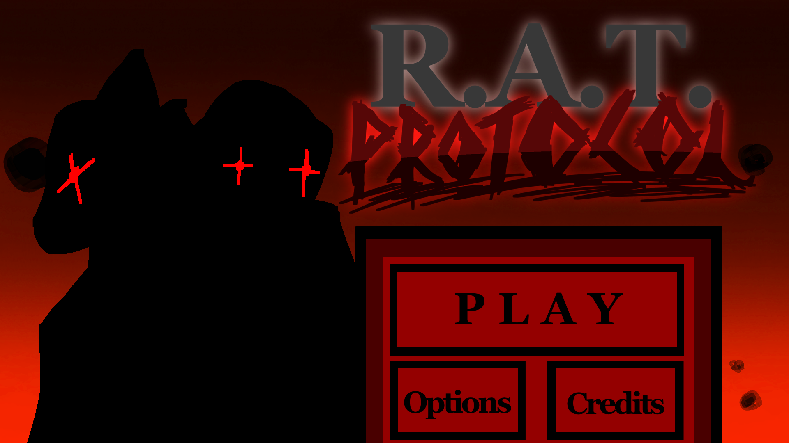
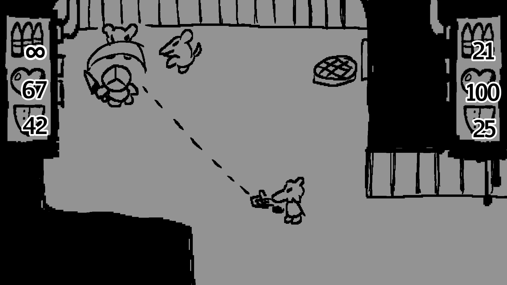

## Game Design Document

Un juego diseñado por: Alejandro Cuaxiloa, Daniel Borges, Javier Borriño Carnerero y David Benítez Vázquez.

# *ÍNDICE.*

<ins>**1\. Introducción**</ins>

[1.1. Título](#titulo)

[1.2. Concepto principal](#concepto-principal)

[1.3. Características principales](#características-principales)

[1.4. Propósito y público objetivo](#propósito-y-público-objetivo)

[1.5. Jugabilidad General](#jugabilidad-general)

[1.6. Estilo visual](#estilo-visual)

[1.7. Plataforma](#plataforma)

[1.8. Licencia](#licencia)

<ins>**2\. Jugabilidad**</ins>

[2.1. Estructura del juego](#estructura-del-juego)

[2.2. Eventos](#eventos)

[2.3. Combate](#combate)

[2.3.1 Selección de personaje](#selección-de-personaje)

[2.3.2 Enemigos](#enemigos)

[2.3.3 Vida, armadura y curación](#vida,-armadura-y-curación)

[2.4. Estados del juego y Diagrama de flujo](#estados-del-juego-y-diagrama-de-flujo)

[2.4.1. Menú principal](#menú-principal)

[2.4.2. Selector de niveles](#selector-de-niveles)

[2.4.3. Misión / Nivel](#misión-nivel)

[2.4.4. Game Over / Pantalla final](#game-over-pantalla-final)

[2.4.5. Diagrama de flujo](#diagrama-de-flujo)

[2.5. Controles](#controles)

[2.5.1 Controles en línea](#controles-en-línea)

[2.5.2 Controles en local](#controles-en-local)

<ins>**3\. Historia**</ins>

[3.1. Trasfondo y lore](#trasfondo-y-lore)

[3.2. Trama](#trama)

[3.3. Personajes](#personajes)

<ins>**4\. Arte, concept art y sonido**</ins>

[4.1. Arte](#arte)

[4.2. Música](#música)

[4.3. Efectos de sonido](#efectos-de-sonido)

# **1\. Introducción.**

## **1.1. Título.**<a id="titulo"></a>

R.A.T Protocol. Rat es el acrónimo de Rapid-Assault Tactics. La intención del título está en que los enemigos del juego son ratas mutantes.

## **1.2. Concepto principal.**<a id="concepto-principal"></a>

El concepto principal del juego consiste en un juego de disparos 2D de vista cenital, en el que un jugador, o dos en cooperativo, deberán adentrarse en mega fábricas y alcantarillas de un mundo de estilo “Dieselpunk” para exterminar y contener hordas de rata-hombres mutantes.

## **1.3. Características principales.**<a id="características-principales"></a>

* El juego se divide en varios niveles con objetivos propios, la progresión será lineal y habrá que superarlos todos para completar el juego.  
    
* En cada nivel, el / los jugadores tendrán que cumplir ciertos objetivos antes de encontrar una salida para poder pasar de pantalla.  
    
* El principal desafío del juego consiste en la abrumadora cantidad de enemigos a los que los jugadores se enfrentarán, las rata-hombres pueden salir de agujeros y alcantarillas constantemente.  
    
* Habrán diferentes armas y objetos repartidos por los niveles que los jugadores podrán recoger y que serán útiles para hacerse paso por éstos.

## **1.4. Propósito y público objetivo.** <a id="propósito-y-público-objetivo"></a>

El propósito del juego es crear una experiencia cooperativa y entretenida siguiendo el gameloop de los “horde shooters” pero en un ambiente 2D, creando un entorno multijugador enfocado a jóvenes de entre 12 y 25 años, que les gusten los “horde shooters” como Left 4 Dead 2 o Darktide, y quieran experimentarlo en una nueva vista parecida a juegos como Hotline Miami.

## **1.5. Jugabilidad General.** <a id="jugabilidad-general"></a>

Los jugadores controlan las fuerzas armadas del protocolo R.A.T., soldados en armadura pesada equipados con armas poco ortodoxas destinadas a eliminar la plaga de las ratas en megafábricas como la del juego. El jugador puede moverse en cuatro direcciones por el escenario, recoger e interactuar con objetos o puntos de interés y atacar en una dirección apuntada ya sea con su arma cuerpo a cuerpo o a distancia. También podrá recargar, arreglar su armadura o curar a su compañero para aguantar la ola de rata-hombres que les acecharan durante la partida.  
Con esto, los jugadores deberán no solo sobrevivir las hordas, sino también llegar a puntos objetivos donde llevar a cabo su misión que ayudará poco a poco a la completa erradicación de la plaga. Una vez la misión esté cumplida, los jugadores deberán hacer una última travesía climática hacia un punto de extracción.

## **1.6. Estilo visual.** <a id="estilo-visual"></a>

Estilo de dibujo pixel art con temática dieselpunk y escenarios de maquinaria interminable y en perpetuo movimiento aunque decrépita, los enemigos varían entre animales antropomórficos, algunos en ropas harapientas mientras que otros pueden estar bien armados y protegidos, y ratas gigantes, además de enemigos especiales que están hechos para resaltar entre ellos y distinguirlos del escenario.  
[**Véase la sección de arte**](#arte)

## **1.7. Plataforma.** <a id="plataforma"></a>

El juego estará destinado a ser jugado en navegador web (HTML5) y así ser fácil de entrar e iniciar una partida rápida además de cooperativa en línea o en local.

## **1.8. Licencia.** <a id="licencia"></a>

El proyecto tendrá la licencia Creative Commons-Attribution-Noncommercial (CC-BY-NC). Que significa que se podrá modificar y redistribuir el trabajo siempre que se dé crédito a los creadores originales. Además de que no se podrá hacer lo anterior con fines lucrativos o comerciales. La razón por la que se ha elegido esta licencia es por el fin académico del proyecto, pero que a su vez en un futuro podría ser vendido por sus creadores.

# **2\. Jugabilidad.**

## **2.1. Estructura del juego.** <a id="estructura-del-juego"></a>

El juego se divide en un número de niveles predeterminados. Cada nivel tiene un objetivo que completar durante la misión, y completar un nivel exitosamente desbloquea el siguiente.  
Dentro de una misión, los jugadores deben de completar un objetivo específico mientras se abren paso por hordas de rata-hombres. Al completar ese objetivo los jugadores podrán escapar por una zona de extracción a la que tendrán que llegar de forma rápida mientras una horda interminable amenaza.  
Los jugadores pueden elegir si especializarse en rango o en cuerpo a cuerpo. Y a lo largo del nivel podrán encontrar objetos que ayuden durante la misión como munición para armas, placas de armadura, o utensilios médicos para recuperarse de heridas y curar al compañero.

## **2.2. Eventos.** <a id="eventos"></a>

A lo largo de un nivel pueden ocurrir muchas cosas y la mayoría sucederá cuando menos se lo espere el jugador. Aunque los niveles sean lineales, la probabilidad de que aparezca una horda o la cantidad de esta puede ser aleatoria, influenciada por el avance o habilidad del jugador. Hay zonas donde obligatoriamente ocurriría una horda, como en zonas objetivos que los jugadores deberán defender, ciertas secciones en mitad del nivel o al completar la misión e intentar extraer. Las hordas se definen como un periodo de tiempo limitado donde la aparición de los enemigos es extremadamente alta y casi interminable, todas las zonas de las que pueden salir saldrán enemigos e inmediatamente irán a por el jugador. Durante una horda hay poco descanso pero una vez esta termine asegura un periodo de tranquilidad donde, a no ser que se fuerce, no sucederá otra horda, y de hacerlo será más débil que la anterior. Cuanto más tiempo entre horda y horda, o más preparados estén los jugadores, más potente puede ser la horda, e incluso tener cualidades especiales.  
Algunas hordas pueden ser ligeramente menos brutales que una horda normal pero incluir enemigos especiales, ya sean más enemigos blindados, uno o dos enemigos muy grandes y fuertes, enemigos incapacitantes o enemigos que amenacen desde la distancia. 

Enemigos especiales también pueden aparecer fuera de una horda y puede ser algo de lo que mantenerse alerta pues algunos resultan ser un peligro si no se tienen en cuenta.

## **2.3. Combate.** <a id="combate"></a>

### **2.3.1 Selección de personaje** <a id="selección-de-personaje"></a>

Los jugadores deciden si quieren tener un arma a distancia o una cuerpo a cuerpo. El jugador que tenga el arma a distancia deberá de usar el ratón para poder apuntar correctamente, mientras que el jugador cuerpo a cuerpo, en caso de no poder usar un ratón o estar jugando en local, puede usar perfectamente 4 teclas adicionales para apuntar en 8 direcciones, que con el arco de su ataque podrá cubrir cualquier peligro, por lo demás los controles son los mismos.

### **2.3.2 Enemigos** <a id="enemigos"></a>

Los jugadores deben de acertar con sus ataques a los enemigos en frente suya, la mayoría de enemigos son **carne de cañón** y de un golpe o una sola bala los mata, cuya fuerza viene en números, intentan rodear al jugador y atacar con sus manos o dientes, intentando derruir su armadura y eventualmente su vida mordisco a mordisco, estos ataques no suponen algo preocupante, pero, como ya mencionado, es la cantidad lo que lo vuelve peligroso.  
También pueden haberlos **acorazados** que aguantan un poco más y están hechos para  atraer la atención a un punto específico en vez de rociar toda la zona de ataques sin pensar.  
Los enemigos **pesados** son como los acorazados pero apareciendo de forma singular y con una cantidad muy superior, además de ataques mucho más dañinos, por lo que muestran una amenaza considerable, por suerte tienen de punto débil su zona trasera, por lo que un dúo bien coordinado podría franquear y derribarlo antes de que suponga un peligro.   
Entre los enemigos acorazados, algunos **rangers** van equipados con armas rudimentarias y mantienen las distancias con el jugador en vez de lanzarse con él, por lo que primero habrá que limpiar los enemigos que rodean al jugador o al ranger para llegar a este.  
Las ocasionales **Ratas de caza** tienen una apariencia resaltante y sonido característico que indica su presencia. Esto es importante porque en vez de atacar como lo hacen sus compañeras, las Ratas de caza se lanzan encima del jugador, incapacitando su movimiento y armas mientras les despieza con sus garras y cuchillas afiladas. Aunque lo recomendable es que un compañero se las quite de encima al otro, en caso de no poder, los jugadores pueden intentar zafarse de estas ratas machacando las teclas de movimiento, el jugador de armas a distancia le costará un rato y no conseguirá matar a la rata de caza, mientras que el jugador cuerpo a cuerpo puede hacerlo mucho más rápido y acabando con la vida de la Rata.

### **2.3.3 Vida, armadura y curación** <a id="vida,-armadura-y-curación"></a>

Los jugadores tienen una barra de vida y otra de armadura, cuando la barra de vida llega a 0, el jugador es derribado, significa que los enemigos lo ignoraran e irán a por el otro jugador, en caso de jugar solo será como haber muerto. Se puede revivir a un compañero caído simplemente interactuando con él por unos segundos, pero volver al juego de esta forma tiene un coste.   
Los jugadores tienen un total de 100 unidades de vida máxima que pueden recuperar siendo curados con botiquines, dividida en 4 “heridas” que pueden tener, al ser derribado y levantado, el jugador pierde una de estas heridas, perdiendo con ella 25 unidades de vida máxima que no podrá recuperar a no ser que se cure en una estación médica encontrada algunas veces por el nivel. Si un jugador es derribado cuando solo le queda una herida, muere, solo podrá volver a la partida si el otro jugador llega a un punto seguro donde salvarlo.  
Si se juega solo o ambos jugadores mueren o están derribados, se considera Game Over y tendrán que volver a intentar desde el último checkpoint.  
Para ayudar, los jugadores también tienen una armadura que sirve de barra de vida adicional, una unidad de armadura vale lo mismo que una unidad de vida, el jugador con armas a distancia tiene 50 de armadura máximo mientras que el jugador con armas cuerpo a cuerpo tiene un total de 100 unidades de armadura, y siempre mantendrá ese máximo de vida a lo largo del nivel. De normal, la armadura se consume antes que la vida al recibir daño.

A lo largo de los niveles, el jugador podrá encontrar **botiquines** y **placas de armadura** para recuperar vida o armadura, los botiquines recuperan 50\* de vida y las placas de armadura 25\* de armadura. También en zonas seguras se pueden encontrar **estaciones médicas** que curan el total de la vida y recuperan 2 heridas al jugador.  
Un jugador puede llevar como máximo la suma de 10 botiquines y placas todo junto. Al curarse, si tiene botiquines, se curará la vida hasta el máximo o hasta no tener más, entonces al curarse arreglará su propia armadura.  
También se puede curar al compañero, con una animación más corta que si se curase uno solo se puede administrar ya sea botiquines o placas de armadura al compañero, si el compañero está derribado en vez de simplemente curarlo lo levantara (todo con el mismo botón).

## **2.4. Estados del juego y Diagrama de flujo** <a id="estados-del-juego-y-diagrama-de-flujo"></a>
### **2.4.1. Menú principal** <a id="menú-principal"></a>

Del menú principal se puede cerrar el juego, abrir las opciones o ir al selector de nivel (indicado como “JUGAR”).

En el menú de opciones se puede controlar el audio del juego así como revisar los controles de los jugadores.

### **2.4.2. Selector de niveles** <a id="selector-de-niveles"></a>

Antes de llegar al selector de niveles al jugador se le presenta la opción de jugar en línea o en local, si decide jugar en línea, el jugador cliente no verá el selector de nivel si no que simplemente esperará a que el jugador huésped elija nivel.  
El selector de niveles deja elegir cualquiera de los niveles disponibles al jugador además de un primer nivel tutorial.

Antes de comenzar un nivel se deja elegir a los jugadores cuál de los dos personajes quieren ser. Una vez hayan elegido comenzará el nivel.

### **2.4.3. Misión / Nivel** <a id="misión-nivel"></a>

Al comenzar una misión ambos jugadores tendrán el mismo HUD, en local verán exactamente lo mismo mientras que en línea cada uno tendrá su cámara enfocada en sí mismo.  
Los jugadores verán el nivel de forma cenital, será fácil distinguir el fondo / suelo del nivel con enemigos y objetivos u objetos de interés y entre zona y zona habrá una breve transición de fundido a negro.  
En el HUD se podrá ver la vida, armadura y munición de cada jugador, la del jugador 1 a la izquierda y el jugador 2 a la derecha, mientras que arriba de la pantalla vendrá información de si hay una horda activa o cual es el siguiente objetivo.

### **2.4.4. Game Over / Pantalla final** <a id="game-over-pantalla-final"></a>

En caso de que ambos jugadores mueran o estén incapacitados al mismo tiempo, tendrá una pantalla de GAME OVER. en la que podrán elegir si volver al selector de nivel o repetir el nivel.

Si consiguen completar la misión y extraer tendrán una pantalla de victoria donde podrán ver estadísticas como daño recibido, cuántas veces han revivido, o cuantas alimañas han exterminado. Después volverán al selector de nivel.

### **2.4.5. Diagrama de flujo** <a id="diagrama-de-flujo"></a>

*Referencia: “Img/flowchart.png”*
```mermaid
flowchart TB
    PCI\[Pantalla_de_carga_inicial] --> Menú;
    Menú --> |iniciar partida|SJ[Selector de jugar en línea o en local];
    Menú <--> OP[opciones];
    SJ --> SN[Selector de niveles];
    SN <--> OP;
    SN --> Menú;
    SN --> |Seleccionar nivel| SP[Selector de personaje];
    SP --> N[Nivel]; 
    N <--> OP;
    N --> |Ambos jugadores muertos o incapacitados al mismo tiempo|GO[Game Over];
    N --> |Seleccionar salir del nivel en el menú| SN;
    N --> |completar misión| V[Pantalla de victoria]; 
    GO -->|volver a intentar| N;
    GO --> |Salir al menú| SN;
    V --> SN;
````

## **2.5. Controles** <a id="controles"></a>

Los controles pueden variar si se juega en línea o en local, uno de los personajes está diseñado para poder ser jugado con los controles adaptados para local para que no haya una desventaja entre los jugadores.

### **2.5.1 Controles en línea** <a id="controles-en-línea"></a>

Estos controles son idénticos para ambos jugadores cuando se juega en línea. En este caso cada jugador apuntaría con el ratón, moviendo el ratón por la pantalla su personaje apuntaría hacia donde ellos tienen el cursor.

- Acción \-\> “tecla”  
- Moverse hacia arriba 			\-\> “W”  
- Moverse hacia abajo			\-\> “S”  
- Moverse hacia la derecha		\-\> “D”  
- Moverse hacia izquierda 		\-\> “A”  
- Disparar					    \-\> “Click izquierdo”  
- Recargar arma / cambiar de modo	\-\> “R”  
- Interactuar					\-\> “Espacio”  
- Curarse (a uno mismo)			\-\> “Q”  
- Curar (al compañero)			\-\> “F”

### **2.5.2 Controles en local** <a id="controles-en-local"></a>

Estos son los controles en local, se recomendará al jugador que juegue sin ratón a ser el jugador con arma cuerpo a cuerpo. El jugador 1 en este caso apunta con el ratón como si jugase en línea, mientras que el jugador 2 en vez de apuntar, ataca directamente con nuevos controles direccionales para golpear con su arma de cuerpo a cuerpo.

*Jugador 1* (jugador a distancia)  
- Moverse hacia arriba 			\-\> “↑”  
- Moverse hacia abajo			\-\> “↓”  
- Moverse hacia la derecha		\-\> “→”  
- Moverse hacia izquierda 		\-\> “←”  
- Disparar					    \-\> “Click izquierdo”  
- Recargar arma / cambiar de modo	\-\> “Click derecho”  
- Interactuar					\-\> “Numpad 0”  
- Curarse (a uno mismo)			\-\> “Ctrl derecho”  
- Curar (al compañero)			\-\> “Shift derecho”

*Jugador 2* (jugador cuerpo a cuerpo)  
- Moverse hacia arriba 			\-\> “W”  
- Moverse hacia abajo			\-\> “S”  
- Moverse hacia la derecha		\-\> “D”  
- Moverse hacia izquierda 		\-\> “A”  
- Atacar hacia arriba			\-\> “Y”  
- Atacar hacia abajo			\-\> “H”  
- Atacar hacia la derecha		\-\> “J”  
- Atacar hacia la izquierda		\-\> “G”

Recargar arma / cambiar de modo	\-\> “R”  
Interactuar					    \-\> “Espacio”  
Curarse (a uno mismo)			\-\> “Q”  
Curar (al compañero)			\-\> “F”

# **3\. Historia.** <a id="historia"></a>

## **3.1. Trasfondo y lore.** <a id="trasfondo-y-lore"></a>

En una realidad alterna, un futuro distante donde la sociedad se ha expandido a todo rincón de este planeta. Megafábricas, la vértebra de la sociedad, se alzan hasta donde alcanza el horizonte, incontables trabajadores viven y mueren a diario para crear maquinaria o mantener la electricidad de los millones que viven alrededor de estas fábricas como si fuesen el corazón de toda ciudad, y en algunos casos llegan a ser ciudades en sí mismas dada su inmensa magnitud. Tales behemoths de la tecnología moderna se mantienen en pie por interés de su función, no necesariamente de sus trabajadores. Es por eso que solo cuando la producción realmente se ve afectada es cuando agencias de seguridad privadas pueden entrar en juego para arreglar cualquier problema inhumano que se pueda hallar en los pulmones que mantiene el mundo en movimiento.

En el sector E-40400, la megafábrica “Queek-HT” sufre de una enfermedad capaz de destruir las sociedades cónyuges, una sociedad nueva, hostil y salvaje. Los extraños químicos y residuos que estas máquinas producen en su profundidad, mucho por debajo de la línea marítima, puede llevar a mutaciones dolorosas y el nacimiento de verdaderas aberraciones de la naturaleza, entre los más comunes son las **Ratas-hombre**, probablemente creados por un proceso lento pero seguro donde las ratas que hayan hogar en una mega fábrica sufren poco a poco de una evolución veloz pero brutal, donde se crea una segunda sociedad por debajo de las narices de todo trabajador o ciudadano, hasta que un día sean tan numeroso y tan inteligentes que aislar secciones de la fábrica no es una opción pues los números llegan a la sexta cifra a lo largo de las profundidades de la fábrica. Solo una opción parece viable, la exterminación.

## **3.2. Trama.** <a id="trama"></a>

Una compañía conocida como A.N.I.M.A.L. Solutions es contratada para limpiar las temibles profundidades de Queek-HT antes de que la plaga de ratas-hombre llegue a niveles superiores. El **protocolo de Tácticas de Asalto Rápidas (Rapid Assault Tactics)** es activado, y tropas de choque son movilizadas por todas las kilométricas hectáreas de Queek para frenar y exterminar a cualquier alimaña que encuentren.  
Los jugadores asumen el puesto de dos de estas tropas, reforzadas con armadura, entrenadas como soldados y armados con tecnología punta, hacen frente a las Ratas humanoides que se retuercen entre las sombras y alcantarillas de Queek-HT, ya sea con planes de contingencia que erradique sus números en masa como acribillando y rebanando criaturas no humanas que hagan contacto con ellos.

## **3.3. Personajes.** <a id="personajes"></a>

Los únicos personajes con los que el jugador llegará a interactuar serán los mismos personajes jugables y una comandante de campo que les hablará por radio.  
La comandante de campo Katherine “Kat”, representada por una foto suya con armadura y casco de batalla con motivos felinos. No se llegará a conocer mucho de su personalidad a parte de su odio hacia las alimañas y despreocupación hacía la integridad de la fábrica en sí más allá de la permitida por superiores y clientes. La comandante de campo se comunicará con los jugadores durante momentos clave como el tutorial, el inicio de un nivel, al empezar un objetivo principal, y a la extracción. Sirve de guía y narradora para que el jugador pueda situarse y saber a dónde ir.

Los personajes jugables no tienen nombre, lo único que se ve de ellos son sus armaduras y armamento. Uno de ellos va armado con lo que parece una ametralladora de cargador de plato como una ametralladora DP baidu pero adaptada al estilo del juego, la armadura de este personaje es más ligera y móvil, además de tener una máscara con cara de zorro. El segundo personaje está enfocado al combate cuerpo a cuerpo, lleva una Espada Rojo Blanco Mk.IV, su armadura es mucho más pesada y tosca, lo distingue un casco con forma de lechuza.

# **4\. Arte, concept art y sonido.** <a id="estilo-visual"></a>

## **4.1. Arte.** <a id="arte"></a>

Todo el arte se encuentra en la carpeta “img” de este trabajo. Se encuentran presentes: 

1er Boceto Tirador (Conejo) <br> 
<br>
2º Boceto Tirador (Zorro) <br>
<br>
Boceto Final Tirador (Zorro) <br>
<br>
Boceto Cuerpo a Cuerpo (Lechuza) <br>
<br>
Boceto Hombre-Rata Base <br>
<br>
Pantalla Principal <br>
<br>
UI y gameplay mockup <br>
<br>


## **4.2. Música.**  <a id="música"></a>

La música del juego busca meter al jugador en el ambiente del mundo sin entorpecer o distraer mucho del flujo de la partida. Por ello se optará por componer música **ambiental** de un tono **oscuro** y ominoso a la vez que sutil y ligero.

Para corresponder mejor con la temática *dieselpunk* del juego. Se hará énfasis en instrumentos correspondientes a los géneros musicales del rock y el jazz \-surgidos tras la segunda revolución industrial, que es en lo que se basa el steampunk-. Además se usarán percusiones metálicas que recuerden a ruidos de una fábrica y posiblemente habrá presencia de sintetizadores.

Para la banda sonora se compondrán temas correspondientes a las siguientes pantallas del juego:

- Pantalla de título.  
- Escena de introducción.  
- Opciones y selección de nivel / personaje.  
- Niveles (un tema distinto por nivel)

## **4.3. Efectos de sonido.** <a id="efectos-de-sonido"></a>

Para complementar el estilo visual, los efectos de sonido buscan tener ese sabor crunchy que el pixel art y la ambientación cruda ofrecen, por lo que la dirección de estos viene muy ligada al uso de bitcrush, con el enfoque de ayudar a la banda sonora a crear dicha atmósfera.

Se implementarán efectos de sonido para:

* Disparar, Atacar a Melé y similares  
* Recargar  
* Moverse  
* Eliminar enemigos   
* Recoger botiquines, armadura y loot  
* Curar, revivir a alguien  
* Recibir daño  
* Ser derribado, morir  
* Sonidos de los enemigos y del entorno  
* Interacciones con los diferentes elementos del entorno  
* Interactuar con los botones del menú
